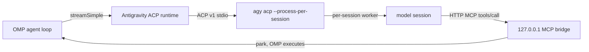

# omp-antigravity-acp

Use a locally signed-in Google Antigravity CLI (`agy`) as an OMP model provider. Models show up in `/model` as `antigravity/<id>`, next to every other provider. OMP owns tools, permissions, compaction, and subagents.

This is **not** OMP's built-in `google-antigravity` HTTP provider. That path sends requests from OMP to Cloud Code Assist, which Google does not want used outside their own tool. This plugin only talks to the official `agy acp` process.

## How it works



| Piece | Behavior |
|---|---|
| Process | Spawns official `agy acp`. Credentials stay in that process and the OS store (macOS Keychain / Windows Credential Manager). |
| Client id | ACP `clientInfo.name` is `jetbrains.dsh`. Antigravity only gives Claude and GPT-OSS to JetBrains / Zed / Xcode whitelist clients; a generic name sees Gemini only. |
| Isolation | Own `--gemini-dir` (default `$OMP_HOME/cache/antigravity-acp`). Isolated `omp-bridge` agent with `tools: []` strips built-in file/terminal tools. Multi-account uses a private `$HOME` per account. |
| Tools | OMP tools are advertised over MCP. Long MCP calls that would hit agy's 180s cap return a still-running notice; the model awaits the same result. OMP still sees one tool call. |
| History | One OMP session reuses one ACP session (`session-index.json` + native `session/load`). Compaction / rewritten history is replayed as a history block. |
| System prompt | First turn via `_meta.antigravity.systemPrompt.append`. Later changes go as `<system_update>`. |

Background: Antigravity ACP whitelist, [antigravity-cli#1318](https://github.com/google-antigravity/antigravity-cli/issues/1318). Model matrix: [Choose a model](https://antigravity.google/docs/models/).

## Install

Requires official `agy` CLI `>= 1.5.0` (`agy update` if older) and a completed terminal login.

```sh
cd omp-antigravity-acp
npm install
npm run build
omp plugin link .
```

From the GitHub repo:

```sh
omp plugin install github:praveenxsharma/dsh-plugin-bundle
```

Restart OMP. Select a model in the **antigravity** group, for example `antigravity/gemini-4-argon`. Thinking levels: Low / Medium / High (`--thinking`).

Install does not patch `agy`. Default context stays 256K. For ~1M, use [`agy-context-unlock`](../agy-context-unlock): put `agy-patch.py` at `~/.gemini/antigravity/tools/agy-patch.py` (Windows: `%USERPROFILE%\.gemini\antigravity\tools\agy-patch.py`). On the next start, `autoPatch` runs it if present. After `agy` upgrades, the plugin re-checks.

| Model | Context | Thinking |
|---|---|---|
| Gemini 4 Argon | 1,048,576 unlocked / 256,000 locked | Low / Medium / High |
| Gemini 3.8 Flash | 1,048,576 unlocked / 256,000 locked | Low / Medium / High |
| Claude Opus 5.5 | 1,048,576 unlocked / 256,000 locked | Low / Medium / High |
| Claude Sonnet 5.5 | 1,048,576 unlocked / 256,000 locked | Low / Medium / High |
| GPT-OSS 120B (Medium) | 131,072 | Medium (fixed) |

Live roster follows ACP `session/new`.

## Commands

| Command | Effect |
|---|---|
| `/agy-status` | Binary, unlock, context window, models, accounts |
| `/agy-login [id] [code]` | Start official browser sign-in, then paste the code |
| `/agy-accounts [add id \| enable id \| disable id]` | List or change the account pool |

Settings file: `$OMP_HOME/cache/antigravity-acp/settings.json` (default `~/.omp/cache/antigravity-acp`).

## Configuration

| Field | Default | Meaning |
|---|---|---|
| `provider` | `antigravity` | Route id (`antigravity/gemini-4-argon`) |
| `command` | empty | Absolute `agy` path; empty searches `~/.local/bin/agy`, `%LOCALAPPDATA%\agy\bin\agy.exe`, then `PATH` |
| `home` | empty | Isolation dir; empty uses `$OMP_HOME/cache/antigravity-acp` |
| `accounts` | `[]` | Account pool. `system: true` is this machine's login |
| `contextWindow` | `0` | `0` = per-model (1M unlocked / 256K locked) |
| `defaultEffort` | `high` | Used when the request has no thinking level |
| `autoPatch` | `true` | Run local `agy-patch.py` before ACP if present |
| `maxLiveSessions` | `16` | Live ACP sessions |
| `idleSessionTtlMs` | `1800000` | Idle recycle |
| `relayAfterMs` | `85000` | Long-tool still-running notice |
| `longDecodeContinuations` | `3` | Auto-continue after output cap |
| `warmup` | `true` | Start ACP and read the catalog on load |

## Limits

- Claude depends on the ACP client whitelist (`jetbrains.dsh`). If Google tightens it, the roster falls back to Gemini.
- No sampling channel: `temperature`, `stop`, `maxTokens` are ignored.
- Windows Credential Manager is not isolated per extra account; extra accounts are a macOS/Linux feature.
- Each account needs one browser authorization. The plugin cannot complete Google login for you.

## Tests

```sh
npm run build && npm test
```

Tests drive `tests/fake-agy.mjs` instead of a real `agy`.
